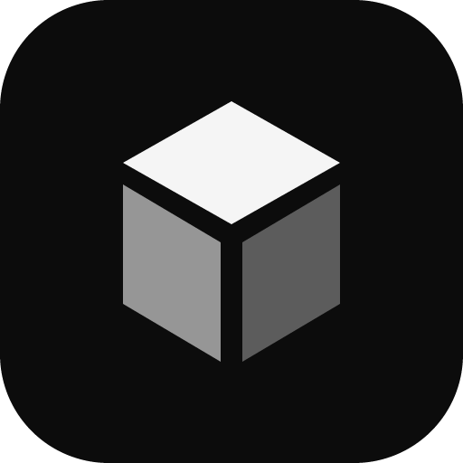

<p align="center"></p>

# AppleLauncher

Лаунчер Minecraft: Java Edition для Windows: монохромный интерфейс, официальный вход через Microsoft, установка версий и загрузчиков (Fabric, Forge, NeoForge, Quilt), моды и сборки с Modrinth, импорт сборок из Prism Launcher и TLauncher, ИИ-ассистент для создания сборок по текстовому запросу.

> **English.** AppleLauncher is a free, open-source (MIT) launcher for Minecraft: Java Edition on Windows. Players sign in with their own Microsoft account (OAuth 2.0 + PKCE in the system browser; the launcher never sees the password), and Microsoft sign-in checks game ownership. Offline nicknames can be added and used without a Microsoft account for singleplayer, LAN, and servers with `online-mode=false`. It installs official versions and the Fabric, Forge, NeoForge and Quilt loaders, and manages mods and modpacks from Modrinth. Game files come only from official servers and are checked by hash. Not affiliated with Mojang or Microsoft.

Electron 45, TypeScript, React 19, Vite (electron-vite), Tailwind 4, Framer Motion, lucide-react. Установку и запуск игры выполняют `@xmcl/core` и `@xmcl/installer`.

## Быстрый старт

```bash
npm install
```

```bash
npm run dev
```

| Команда | Что делает |
| --- | --- |
| `npm run dev` | Запуск в режиме разработки с горячей перезагрузкой интерфейса |
| `npm run typecheck` | Проверка типов main/preload и renderer |
| `npm test` | Юнит-тесты чистых функций (`tests/`) |
| `npm run build` | Сборка в `out/` |
| `npm run dist` | Проверка типов, сборка и установщик NSIS в `dist/AppleLauncher-Setup-<версия>.exe` |
| `npx electron scripts/make-icon.mjs` | Пересоздать `build/icon.png` из `src/renderer/src/assets/icon.svg` |

Нужен Node.js 22.6 или новее: тесты запускают TypeScript без сборки.

## Что нужно настроить самостоятельно

### 1. Вход через Microsoft

Лаунчер не собирает пароли: вход проходит в системном браузере по OAuth 2.0 + PKCE, ответ возвращается на `http://localhost:<порт>`.

В лаунчер встроен Client ID приложения Azure «AppleLauncher» (`cf19bd3a-0d9c-4c7a-b791-4ca1647cb852`, личные учётные записи Microsoft); пользователям ничего настраивать не нужно. Client ID — не секрет, его можно хранить в коде.

**Обязательно один раз:** подать заявку Mojang на доступ к Minecraft API с этим ID: [aka.ms/mce-reviewappid](https://aka.ms/mce-reviewappid). Пока заявка не одобрена, вход доходит до последнего шага и лаунчер сообщает, что приложение не одобрено Mojang.

В приложении Azure должны быть: Redirect URI `http://localhost` на платформе «Мобильные и классические приложения» и «Разрешить потоки общедоступных клиентов» = «Да» (раздел «Проверка подлинности»).

Свой ID можно подставить в **Настройки → Дополнительно** или переменной окружения `APPLELAUNCHER_MS_CLIENT_ID`. Порядок: поле в настройках, затем переменная, затем встроенный ID.

Других ключей для запуска игры не нужно: Modrinth, Mojang, Fabric, Quilt, Forge и NeoForge работают без API-ключей.

### 1а. ИИ-ассистент

Раздел **Сборки → ИИ-ассистент**. Опишите сборку словами («лёгкая сборка для слабого ПК с шейдерами», «техно-сборка с Create на 1.20.1») — агент подберёт версию игры, загрузчик и моды, покажет план, а после вашего подтверждения создаст профиль и скачает моды.

Агент работает на бесплатных моделях [OpenRouter](https://openrouter.ai) (OpenAI-совместимый API). Список моделей лежит в `src/main/ai-config.ts` в порядке предпочтения: если модель перегружена, убрана или ответила пусто, берётся следующая. Бесплатные модели на OpenRouter часто меняются, поэтому иногда запускайте `node test-openrouter.mjs <ключ>` и обновляйте список. Ключ встроен в лаунчер, поэтому игроку ничего вводить и активировать не нужно, а в интерфейсе нет ни названия модели, ни провайдера. Переменная окружения `OPENROUTER_API_KEY` переопределяет встроенный ключ. Всё, что лежит внутри установленного приложения, можно извлечь, а у бесплатного ключа одна общая суточная квота на всех игроков (один запрос ассистента тратит до 12 обращений к модели), поэтому при широком распространении пустите запросы через свой прокси.

Работа в фоне и библиотеки:

- Ассистент не привязан к вкладке: можно уйти с «Сборок» на любую другую страницу, он продолжит работать. В правом нижнем углу показывается виджет (`components/AiDock.tsx`) с ходом подбора, планом, прогрессом установки и итогом; из него можно остановить работу или вернуться на вкладку. Состояние сессии живёт в `ai-session.tsx` над всеми страницами.
- В плане показываются библиотеки, которые потребуются выбранным модам (обязательные зависимости с Modrinth). При создании сборки они скачиваются вместе с модами. Если зависимость мода не установилась, мод откатывается целиком, чтобы игра не падала при запуске.
- После модов лаунчер сразу скачивает игру, загрузчик, Java и библиотеки игры (`prefetch` в `minecraft.ts`), поэтому первый запуск мгновенный. Если это не удалось, всё скачается при первом запуске, как раньше. Пока идёт такое скачивание, кнопка «Играть» просит подождать.

Как это устроено (`src/main/ai.ts`):

- Модель общается с лаунчером короткими JSON-командами: `set_target` (версия и загрузчик) → `search_mods` (несколько раз) → `final`. Все команды выполняет лаунчер по реальному API Modrinth, поэтому идентификаторы и версии модов берутся с Modrinth, а не из памяти модели. Не больше 12 ходов за запрос.
- Итоговый список проверяется: мод должен существовать, быть модом (не ресурспаком) и иметь сборку под выбранные версию игры и загрузчик. Выдуманные и несовместимые id отбрасываются, об их числе сообщается.
- **Добавление модов в готовую сборку.** Вверху вкладки ассистента переключатель «Новая сборка / Добавить в существующую». Во втором режиме версия игры и загрузчик берутся из выбранного профиля, ассистент видит список установленных модов, не предлагает их повторно и не меняет цель. Моды и их библиотеки докачиваются в тот же профиль: остальные моды, настройки и миры не трогаются, игра заново не скачивается. Если установка прервана или не удалась, удаляются только файлы этого запуска.
- **Кнопка ✨ на карточке сборки** («Сборки → Мои сборки») открывает ассистента сразу в режиме добавления модов в эту сборку.
- **Исправление сбоя.** Если игра упала, на главной под кнопкой «Играть» появляется панель «Исправить с ИИ». Лаунчер отдаёт модели список установленных модов, конец `latest-game.log` и новейший отчёт из `crash-reports/`; модель отвечает JSON-командой `fix` (какие файлы отключить, какие моды доставить, найденные через `search_mods`). Всё проверяется: отключать можно только реальные файлы из папки модов (они лишь переименовываются в `.jar.disabled`, ничего не удаляется), добавлять только существующие на Modrinth моды с версией под сборку. Если причина не в модах (память, Java, драйвер), ассистент просто объясняет её и ничего не меняет. Код: `fixCrash` в `src/main/ai.ts`, интерфейс: `components/CrashFix.tsx`.
- Модель ничего не устанавливает. Профиль и моды создаются только после нажатия «Создать сборку»; моды можно выключить по одному. Зависимости ставятся автоматически, файлы проверяются по sha512, сбой одного мода не отменяет остальные.
- Запросы к ИИ идут из основного процесса, ключ в окно интерфейса не передаётся, CSP интерфейса не менялась. Уходит только запрос игрока и результаты поиска модов.
- Тексты из ответов Modrinth считаются недоверенными данными (модели сказано не выполнять инструкции из них), а всё, что вернула модель, проходит проверку схемой zod и очищается перед показом.


### Свой ключ OpenRouter (инструкция для игроков)

Встроенный бесплатный ключ один на всех, и его суточный лимит может закончиться: тогда ассистент пишет «Дневной лимит бесплатного ИИ исчерпан» (или «Превышен лимит запросов»), а под ошибкой появляется подсказка «Как это сделать». Свой ключ бесплатный:

1. Откройте [openrouter.ai/keys](https://openrouter.ai/keys) и войдите через Google или GitHub.
2. Нажмите **Create Key**, введите любое имя (например, AppleLauncher), лимит оставьте пустым.
3. Скопируйте ключ (`sk-or-v1-…`): он показывается один раз.
4. Вставьте его в окно подсказки под ошибкой или в **Настройки → Дополнительно → ИИ-ассистент → Свой ключ OpenRouter** и сохраните. Повторите запрос.

Ключ хранится только на компьютере игрока. Чтобы вернуться к встроенному, очистите поле. Если лимит закончился и со своим ключом, пополнение баланса OpenRouter примерно на $10 поднимает суточный лимит бесплатных моделей с ~50 до ~1000 запросов.

### 2. Автообновления (по желанию)

Обновления берутся из релизов репозитория `ssearazer/applelauncher` (см. `electron-builder.yml`). Публикуйте релизы с `.exe`, `.exe.blockmap` и `latest.yml` из `dist/`. Установленный лаунчер проверяет обновления при запуске (это можно отключить в настройках) и ставит их при выходе.

### 3. Подпись кода (по желанию)

Без сертификата Windows SmartScreen покажет предупреждение при первом запуске установщика. Для подписи задайте `CSC_LINK` и `CSC_KEY_PASSWORD` перед `npm run dist`.

## Как это устроено

```
src/main/        процесс Electron: окно, IPC, установка и запуск игры, аккаунты, моды, сборки, ИИ-агент (ai.ts)
src/preload/     узкий API window.api через contextBridge
src/renderer/    интерфейс React
src/shared/      общие типы и чистые функции
tests/           тесты node:test
```

- **Запуск:** профиль → обновление токена → Java (рантайм Mojang для нужной версии или свой путь) → клиент, библиотеки и ресурсы с проверкой SHA-1 → установка загрузчика → аргументы → отдельный процесс → журнал `logs/latest-game.log` и отслеживание падений.
- **Данные:** настройки, профили и аккаунты лежат JSON-файлами в `%APPDATA%/AppleLauncher` и записываются атомарно. Игра по умолчанию живёт в `%APPDATA%/.applelauncher`, у каждого профиля своя папка `instances/<id>`.
- **Токены:** refresh-токен Microsoft и токен Minecraft шифруются через Electron `safeStorage` (Windows DPAPI, привязка к пользователю Windows).

## Безопасность

- `contextIsolation`, `sandbox`, `nodeIntegration: false`, строгая CSP, переходы и новые окна заблокированы, все запросы разрешений отклоняются.
- Каждый IPC-канал проверяет отправителя и аргументы схемами zod; лишние аргументы отклоняются.
- Пути из архивов и ответов API проходят `safeJoin` и не выходят за папку профиля. Файлы и папки пользователь выбирает только в системных диалогах.
- Загрузки идут только по HTTPS, во временный файл, с проверкой SHA-1/SHA-512 и повторами с паузой. В `.mrpack` разрешены лишь хосты из белого списка Modrinth.
- Внешние ссылки открываются только для белого списка доменов.
- Вход через Microsoft проверяет наличие купленной игры. Оффлайн-ник можно добавить и использовать без аккаунта Microsoft; он работает в одиночной игре, по LAN и на серверах с `online-mode=false`.

## Отступления от макета

- Вторичный текст в светлой теме — `#737373` вместо `#777777`: `#777` на белом даёт контраст 4.48:1, ниже порога WCAG 4.5:1.
- Кнопки окна — системные кнопки Windows (`titleBarOverlay`) со Snap Layouts, а не «светофор» macOS.

## Известные ограничения

- Размер загрузки до установки не показывается: точный объём известен только после разбора манифеста версии; прогресс показывает скачанное и общее.
- Каталог версий показывает Release и Snapshot; старые alpha и beta скрыты.
- Подтверждение удаления версии или мода — системный диалог Windows.
- Названия фоновых задач в верхней полосе пока только на русском.

## Лицензия

MIT, см. [LICENSE](LICENSE). Minecraft — товарный знак Mojang AB; проект не связан с Mojang и Microsoft.
